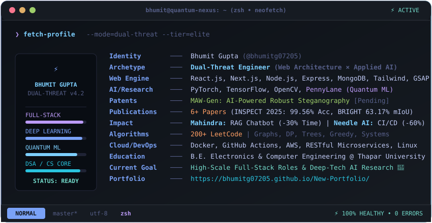

<div align="center">

<!-- ======================================================== -->
<!-- 🚀 HERO BANNER & REAL-TIME INTERACTIVE STATUS HUB        -->
<!-- ======================================================== -->

<a href="https://bhumitg07205.github.io/New-Portfolio/">
  
</a>

<!-- Real-time Typing Subtitle (Tokyo Night Neon) -->
<a href="https://bhumitg07205.github.io/New-Portfolio/">
  
</a>

<p align="center">
  
  
  
</p>

<!-- Quick Action Interactive Badges -->
<p align="center">
  <a href="https://bhumitg07205.github.io/New-Portfolio/"></a>
  <a href="https://www.linkedin.com/in/Bhumitg07205"></a>
  <a href="mailto:bhumit07205@gmail.com"></a>
  <a href="https://leetcode.com/u/bhumitg07205/"></a>
  <a href="https://holopin.io/@bhumitg07205"></a>
</p>

---

<!-- ======================================================== -->
<!-- 💻 GRAPHICAL TERMINAL DIAGNOSTICS (SVG EMBED)            -->
<!-- ======================================================== -->

<p align="center">
  
</p>

<details>
  <summary align="center"><strong>💻 Click to expand plain-text terminal output</strong></summary>
  <br>

```zsh
bhumit@quantum-nexus: ~ (zsh • neofetch)
────────────────────────────────────────────────────────────────────────────────────────
❯ fetch-profile --mode=dual-threat --tier=production-grade
  ⚡ Identity    : Bhumit Gupta (@bhumitg07205)
 ╱  ╲ Archetype   : Dual-Threat (Distributed Systems Architect × Deep-Tech AI)
╱    ╲ Deployments : GeTin-Atithi (Play Store v7) • Pilot Parking (YOLOv8 + TrOCR)
│ 🔬 │ Full-Stack  : Next.js 15, React 19, TypeScript, PostgreSQL 16, Redis 7, Prisma
╲    ╱ Deep Tech   : PyTorch, YOLOv8, TrOCR, OpenCV, PennyLane (Quantum ML)
 ╲  ╱  Patents     : MAW-Gen: Adaptive Watermarking Framework [Patent-Pending]
  ▼   Research    : 6+ Papers (INSPECT 2025: 99.56% Acc, BRIGHT Benchmark: 63.17% mIoU)
      Industry    : Mahindra & Mahindra RAG (-30% Time) • Needle AI (-60% Deploy Latency)
      Algorithms  : 200+ LeetCode Solved [DP, Heaps, Segment Trees, Graph Theory]
[DAEMONS ONLINE]  : [getin-atithi.service] [pilot-parking-anpr.worker] [redis-pubsub-sse] ⚡
```

</details>

---

<!-- ======================================================== -->
<!-- 📊 EXECUTIVE KPI DASHBOARD (4 HIGH-IMPACT TILES)         -->
<!-- ======================================================== -->

| 🚗 Autonomous Vision | 🛡️ Campus IoT Security | 🔬 Deep-Tech Steganography | 🏭 Enterprise AI ROI |
| :---: | :---: | :---: | :---: |
| <br><sub>YOLOv8 + TrOCR Pipeline</sub> | <br><sub>Client Canvas (5MB → 45KB)</sub> | <br><sub>PSNR 54.95 dB (INSPECT 2025)</sub> | <br><sub>RAG Pipeline @ Mahindra</sub> |

---

</div>

<!-- ======================================================== -->
<!-- 🚀 FLAGSHIP PROJECTS: SIDE-BY-SIDE GRAPHICAL SHOWCASE    -->
<!-- ======================================================== -->

## 🚀 Flagship Engineering Deployments

<table>
<tr>
<th width="50%" align="center">
  <h3>🛡️ GeTin-Atithi</h3>
  <em>Campus IoT Security &amp; Distributed Visitor Platform</em>
</th>
<th width="50%" align="center">
  <h3>🚗 Pilot Smart Parking</h3>
  <em>Autonomous Vision ANPR &amp; Slot Allocation Engine</em>
</th>
</tr>
<tr>
<td valign="top">

<p align="center">
  
  
  
  
  
  
</p>

- **Automated Gate Intakes:** Sub-3-second QR intake replacing paper registers across 4 campus gates.
- **Hardware Idempotency Locks:** Redis `SETNX` (12s TTL) over TCP/LAN to trigger mechanical boom barriers with zero duplicate pulses.
- **10-Digit Mobile Auto-Linking:** Vets domestic helpers (maids, cooks) across multiple faculty homes with permanent master QR passes.
- **Client Canvas Compression:** Shrinks ID proofs directly on device from **5MB to 45KB (98% bandwidth reduction)**, avoiding server OOM crashes.
- **Redis Pub/Sub + SSE Stream:** Replaced 70K+ daily polling queries with sub-50ms push alerts and 1-tap campus emergency lockdown.

<details>
<summary><strong>📐 View IoT Security Architecture Flowchart</strong></summary>

```
[Visitor/Staff Node] ──► [Canvas 5MB→45KB] ──► [AWS S3]
         │
         ▼
[Next.js 15 + Prisma Engine]
         ├──► [Redis SETNX Lock] ──► [TCP Micro-controller] ──► [Gate Opens]
         └──► [Redis Pub/Sub] ──► [SSE Stream <50ms] ──► [1-Tap Campus Lockdown]
```
</details>

</td>
<td valign="top">

<p align="center">
  
  
  
  
  
  
</p>

- **Sub-2s Barrier Latency:** Real-time license plate detection and character extraction on Honeywell RTSP IP camera streams.
- **YOLOv8 + TrOCR Vision:** Cascaded neural pipeline achieving robust text extraction through extreme angles, rain, and night glare.
- **Levenshtein Fuzzy Matching:** Dynamic edit-distance matching across vehicle allowlists (`GREEN`/`BLUE`/`RED`), resolving OCR character confusion (`0`/`O`, `1`/`I`, `8`/`B`).
- **$\mathcal{O}(\log n)$ Heap Engine:** In-memory Min-Heap for $\mathcal{O}(1)$ closest open slot extraction + Segment Tree for instant zone occupancy queries.
- **Postgres Row-Level Locks:** `SELECT ... FOR UPDATE` prevents race conditions and double-booking during morning peak rush hours.

<details>
<summary><strong>📐 View ANPR Vision Pipeline Flowchart</strong></summary>

```
[Honeywell RTSP Stream]
         │
         ▼
[YOLOv8 Plate Bounding Box (~15ms)] ──► [TrOCR Vision Transformer]
                                                     │
                                                     ▼
[Postgres Row Lock] ◄── [Levenshtein Fuzzy Match] ◄── [Plate Text]
         │
         ▼
[Min-Heap O(log n) Slot Assign] ──► [Relay Pulse <2s] ──► [Barrier Opens]
```
</details>

</td>
</tr>
</table>

---

<!-- ======================================================== -->
<!-- 🔬 RESEARCH & INDUSTRY (INTERACTIVE COLLAPSIBLES)        -->
<!-- ======================================================== -->

## 🔬 Peer-Reviewed Research & Enterprise Velocity

<details open>
<summary><strong>📑 Peer-Reviewed Research Publications & Patent-Pending IP (Click to inspect)</strong></summary>
<br>

| Venue / Status | Focus Domain | Key Validated Result |
| :--- | :--- | :--- |
| **Accepted @ INSPECT 2025** | Hybrid Traditional-Neural Steganography, Confidence Fusion | **99.56% Extraction Accuracy** for 8-256 bit payloads; **PSNR 54.95 dB** |
| **Journal Paper (BRIGHT Benchmark)** | Satellite Remote Sensing, DeepLabV3+, Dual-Stream ResNet50 | **63.17% mIoU** across 7 global disaster categories |
| **Patent-Pending (IP)** | **MAW-Gen:** AI-Powered Adaptive Watermarking Framework | Feature-space wavelet embedding; immune to GAN/diffusion inpainting attacks |
| **Thapar Research Initiative** | Hybrid Classical-Quantum Machine Learning (PennyLane) | **90%+ Diagnostic Accuracy** on the MIAS medical imaging dataset |

</details>

<details>
<summary><strong>💼 Industrial Trajectory & Corporate Velocity (Click to inspect)</strong></summary>
<br>

* **Summer Intern @ Mahindra & Mahindra Ltd.:** Architected **Machine Chatbot Pro**, an enterprise RAG assistant with dense vector embeddings & recursive chunking, delivering **70%+ precision** and cutting frontline issue resolution time by **30%**.
* **Full-Stack Developer @ Needle AI:** Built and deployed scalable MERN services serving **100+ concurrent active users**; containerized CI/CD pipelines reducing deployment latency by **60%**.
* **Research Assistant @ Thapar University:** Investigated Variational Quantum Classifiers (VQC) using **PennyLane** to map high-dimensional classical vectors to simulated quantum Hilbert spaces.

</details>

---

<!-- ======================================================== -->
<!-- 🛠️ TECHNICAL ARSENAL (COMPACT ICON GRID)                 -->
<!-- ======================================================== -->

## 🛠️ The Technical Arsenal

<div align="center">

| Domain | Technologies & Frameworks |
| :--- | :--- |
| **🧠 AI, Vision & Quantum** | `PyTorch` `TensorFlow` `YOLOv8` `TrOCR` `PennyLane (Quantum ML)` `OpenCV` `HuggingFace` `Scikit-Learn` |
| **🌐 Distributed Full-Stack** | `Next.js 15` `React 19` `React Native (Expo SDK 54)` `Node.js` `Express.js` `PostgreSQL 16` `Redis 7` `MongoDB` `Prisma` `Tailwind CSS` `Three.js` |
| **⚙️ Cloud, DevOps & Core** | `AWS (ECS/SQS/S3)` `Docker` `GitHub Actions` `Linux` `Python` `C++` `C` `TypeScript` `JavaScript` `LeetCode 200+` |

</div>

---

<!-- ======================================================== -->
<!-- 📈 REAL-TIME GITHUB ANALYTICS & ACTIVITY GRAPH           -->
<!-- ======================================================== -->

<div align="center">

## 📈 Real-Time Engineering Velocity

<table>
<tr>
<td width="50%" align="center">

<picture>
  <source media="(prefers-color-scheme: dark)" srcset="https://github-readme-stats.vercel.app/api?username=bhumitg07205&show_icons=true&theme=tokyonight&hide_border=true&include_all_commits=true&count_private=true&bg_color=0D1117&title_color=7aa2f7&icon_color=bb9af7&text_color=c0caf5">
  <source media="(prefers-color-scheme: light)" srcset="https://github-readme-stats.vercel.app/api?username=bhumitg07205&show_icons=true&theme=default&hide_border=true&include_all_commits=true&count_private=true">
  
</picture>

</td>
<td width="50%" align="center">

<picture>
  <source media="(prefers-color-scheme: dark)" srcset="https://github-readme-streak-stats.herokuapp.com/?user=bhumitg07205&theme=tokyonight&hide_border=true&background=0D1117&stroke=7aa2f7&ring=7dcfff&fire=7dcfff&currStreakNum=c0caf5&sideNums=c0caf5&currStreakLabel=7dcfff">
  <source media="(prefers-color-scheme: light)" srcset="https://github-readme-streak-stats.herokuapp.com/?user=bhumitg07205&theme=default&hide_border=true">
  
</picture>

</td>
</tr>
</table>

<!-- Contribution Eating Snake Animation -->
<picture>
  <source media="(prefers-color-scheme: dark)" srcset="https://raw.githubusercontent.com/bhumitg07205/bhumitg07205/output/github-snake-dark.svg">
  <source media="(prefers-color-scheme: light)" srcset="https://raw.githubusercontent.com/bhumitg07205/bhumitg07205/output/github-snake.svg">
  
</picture>

<!-- Trophies & Holopin Row -->
<p align="center">
  <a href="https://github.com/ryo-ma/github-profile-trophy">
    
  </a>
</p>

<details>
  <summary align="center"><strong>🎖️ View Cryptographic Proof-of-Work Badges (Holopin Board)</strong></summary>
  <br>
  <p align="center">
    <a href="https://holopin.io/@bhumitg07205" target="_blank">
      
    </a>
  </p>
</details>

---

<!-- ======================================================== -->
<!-- 🌐 OMNI-CHANNEL CONNECT FOOTER                           -->
<!-- ======================================================== -->

<a href="https://bhumitg07205.github.io/New-Portfolio/">
  
</a>
&nbsp;
<a href="https://www.linkedin.com/in/Bhumitg07205">
  
</a>
&nbsp;
<a href="mailto:bhumit07205@gmail.com">
  
</a>
&nbsp;
<a href="https://leetcode.com/u/bhumitg07205/">
  
</a>
&nbsp;
<a href="https://instagram.com/bhumitgupta_07205">
  
</a>

<br><br>

<p align="center">
  
</p>

<sub>Crafted with engineering rigor & interactive precision • © 2026 Bhumit Gupta. All Rights Reserved.</sub>

</div>
